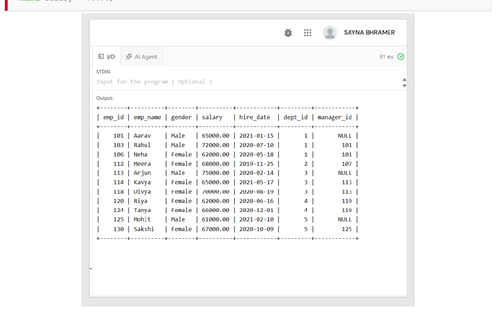
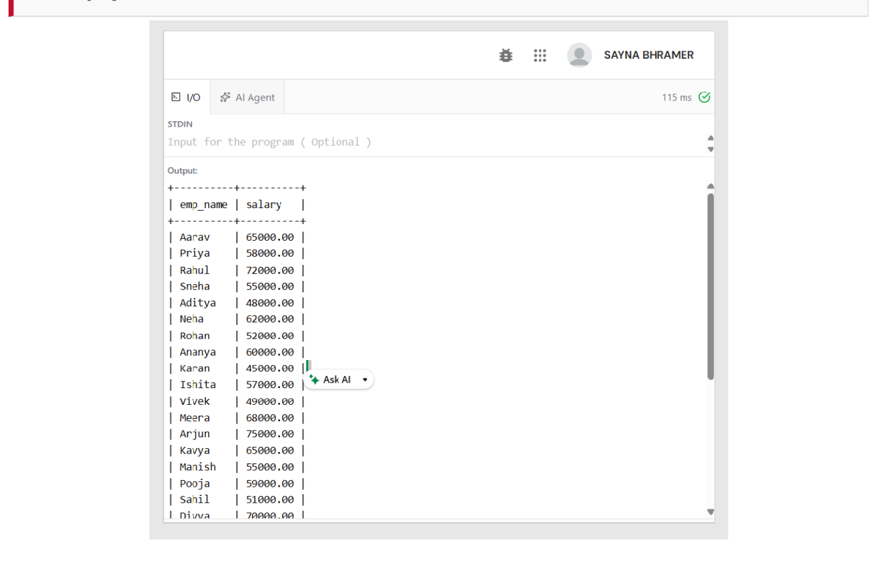
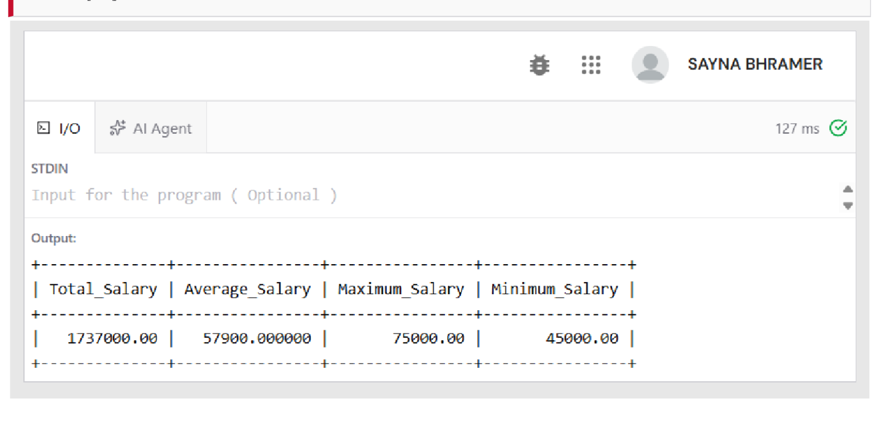
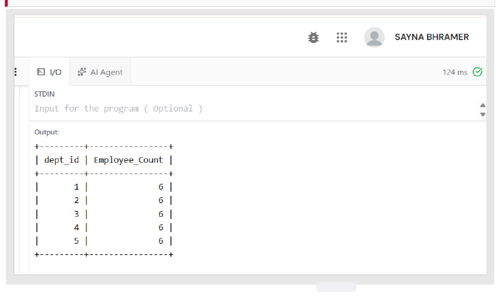
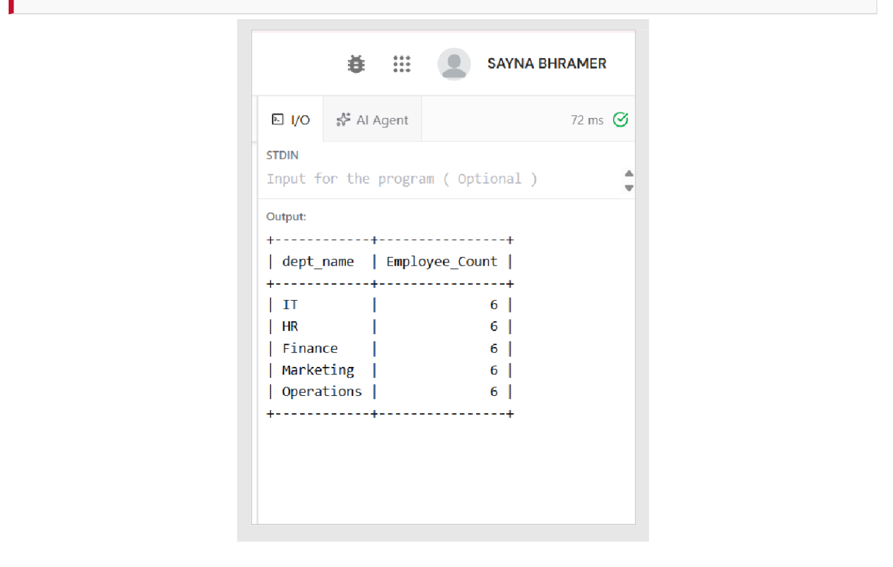
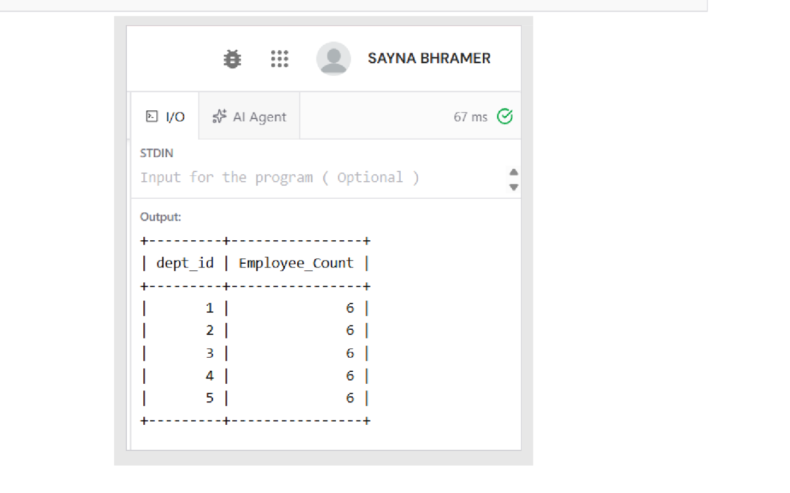
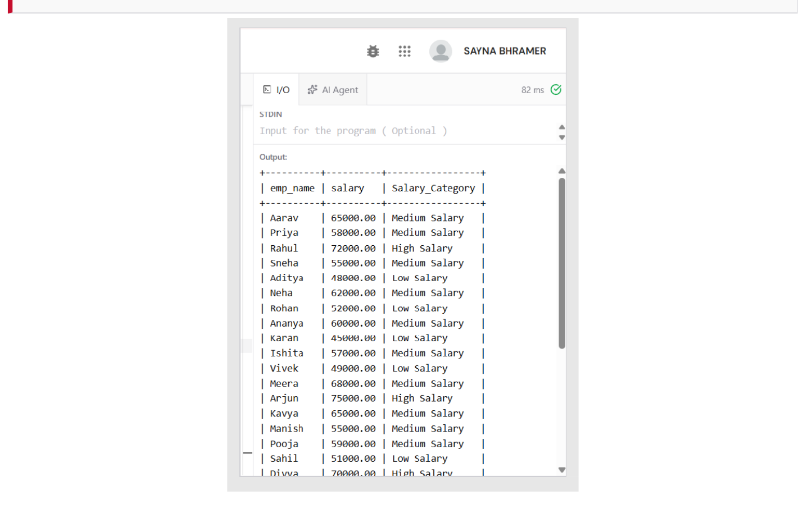
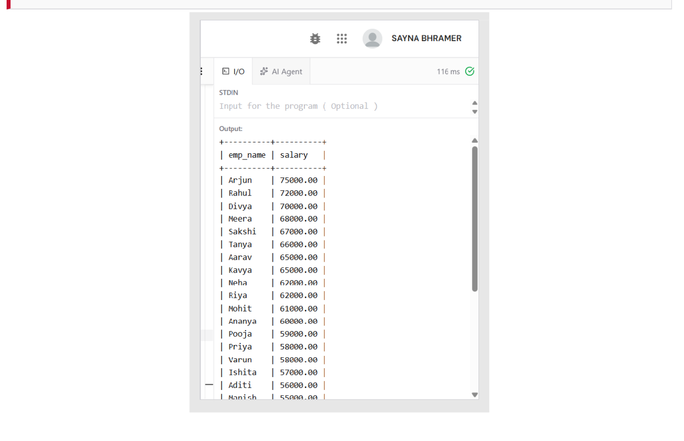

# Experiment 03: Employee–Department–Project Relational Schema

## Aim
To design an **Employee–Department–Project** relational schema in MySQL, populate it with 30 employees across 5 departments and 8 projects, and write SQL queries demonstrating **selection**, **projection**, **aggregate functions**, **GROUP BY**, **HAVING**, **CASE expressions**, and **ORDER BY**.

---

## Software / Tools Required
| Component | Specification |
| :--- | :--- |
| **DBMS** | MySQL Server 8.0 (Community Edition) |
| **Query Editor** | Online MySQL compiler / MySQL Workbench 8.0 |
| **Operating System** | Windows 11 |
| **Language** | SQL (DDL, DML, DQL) |

---

## Theory
- **Relational Algebra in SQL**: Every SELECT statement is a composition of relational-algebra operators. The WHERE clause implements selection ($\\sigma$) — it keeps rows (tuples) satisfying a predicate. The column list implements projection ($\\pi$) — keeping only specified attributes.
- **Aggregate Functions**: COUNT, SUM, AVG, MAX, MIN reduce a set of rows to one summary value. COUNT(*) counts rows; others ignore NULLs.
- **GROUP BY & HAVING**: GROUP BY partitions rows into groups sharing column values, computing aggregates per group. HAVING filters groups *after* aggregation, while WHERE filters rows *before* grouping.
- **CASE Expression**: Evaluates conditional expressions top-down, returning the first matching value for derived attributes like salary bands.
- **ORDER BY**: Sorts the output (ASC by default, DESC for descending).

---

## Database / Table Structure

The schema comprises four relations:
1. department (dept_id, dept_name, location)
2. employee (emp_id, emp_name, gender, salary, hire_date, dept_id, manager_id)
3. project (project_id, project_name, dept_id, udget, start_date)
4. works_on (emp_id, project_id, hours_worked) — resolves $ relationship

---

## SQL Code
The complete DDL, DML, and query definitions are available in [experiment03.sql](./experiment03.sql).

---

## Procedure & Queries Executed

### Q3.1: Selection ($\\sigma$) — Employees earning more than ₹60,000
`sql
SELECT *
FROM employee
WHERE salary > 60000;
`
**Output Screenshot:**

---

### Q3.2: Projection ($\\pi$) — Only Name and Salary columns
`sql
SELECT emp_name, salary
FROM employee;
`
**Output Screenshot:**

---

### Q3.3: Aggregate Functions — Company-wide salary statistics
`sql
SELECT SUM(salary) AS Total_Salary, 
       AVG(salary) AS Average_Salary, 
       MAX(salary) AS Maximum_Salary, 
       MIN(salary) AS Minimum_Salary
FROM employee;
`
**Output Screenshot:**

---

### Q3.4: GROUP BY — Head-count per department
`sql
SELECT dept_id, COUNT(*) AS Employee_Count
FROM employee
GROUP BY dept_id;
`
**Output Screenshot:**

---

### Q3.5: GROUP BY with Department Names
`sql
SELECT d.dept_name, COUNT(e.emp_id) AS Employee_Count
FROM department d
JOIN employee e ON d.dept_id = e.dept_id 
GROUP BY d.dept_id, d.dept_name;
`
**Output Screenshot:**

---

### Q3.6: HAVING — Departments with at least 5 employees
`sql
SELECT dept_id, COUNT(*) AS Employee_Count
FROM employee
GROUP BY dept_id 
HAVING COUNT(*) >= 5;
`
**Output Screenshot:**

---

### Q3.7: CASE Expression — Salary Banding
`sql
SELECT emp_name, salary,
    CASE 
        WHEN salary >= 70000 THEN 'High Salary' 
        WHEN salary >= 55000 THEN 'Medium Salary' 
        ELSE 'Low Salary' 
    END AS Salary_Category
FROM employee;
`
**Output Screenshot:**

---

### Q3.8: ORDER BY — Employees ranked by salary (Highest first)
`sql
SELECT emp_name, salary
FROM employee
ORDER BY salary DESC;
`
**Output Screenshot:**

---

## Result / Conclusion
The **Employee–Department–Project** schema was created with primary-key, foreign-key, NOT NULL, UNIQUE, and CHECK constraints, and populated with 30 employees, 5 departments, and 8 projects. All eight queries ran and returned expected results:
- 11 employees earn above ₹60,000.
- Total payroll is ₹17,37,000, with an average of ₹57,900, maximum of ₹75,000 (Arjun), and minimum of ₹45,000 (Karan).
- Each of the 5 departments has exactly 6 employees, passing the HAVING COUNT(*) >= 5 filter.
- The CASE expression categorized 3 employees in High band ($\\ge$ ₹70,000), 15 in Medium ($\\ge$ ₹55,000), and 12 in Low.
