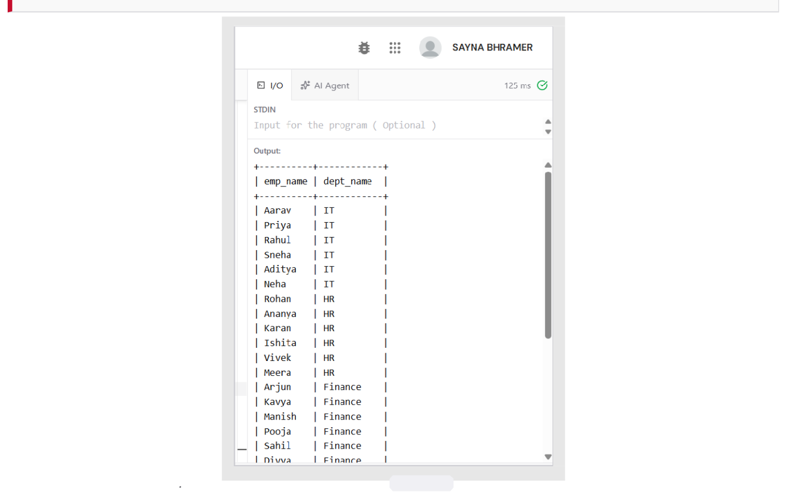
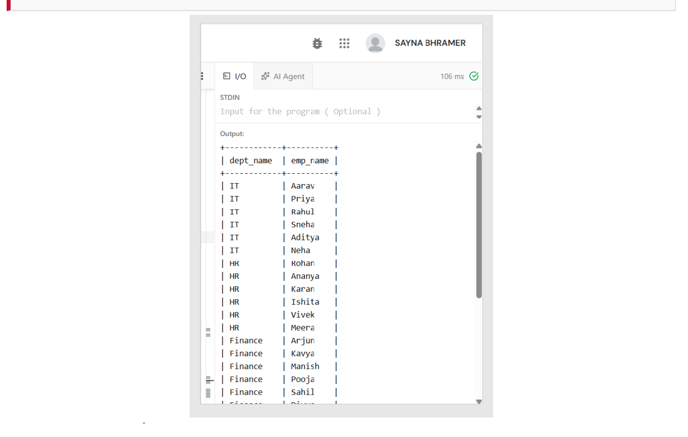
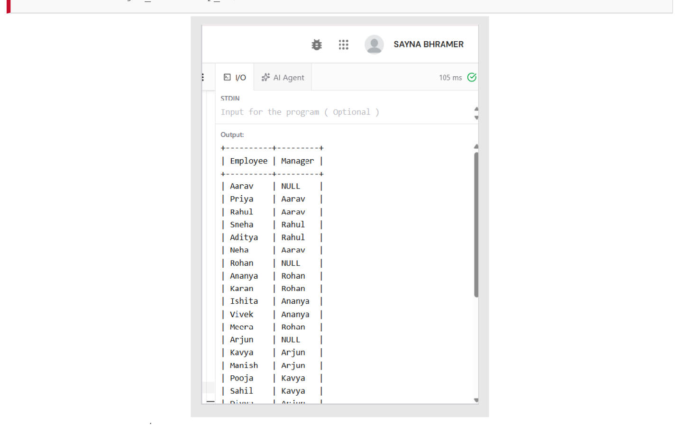
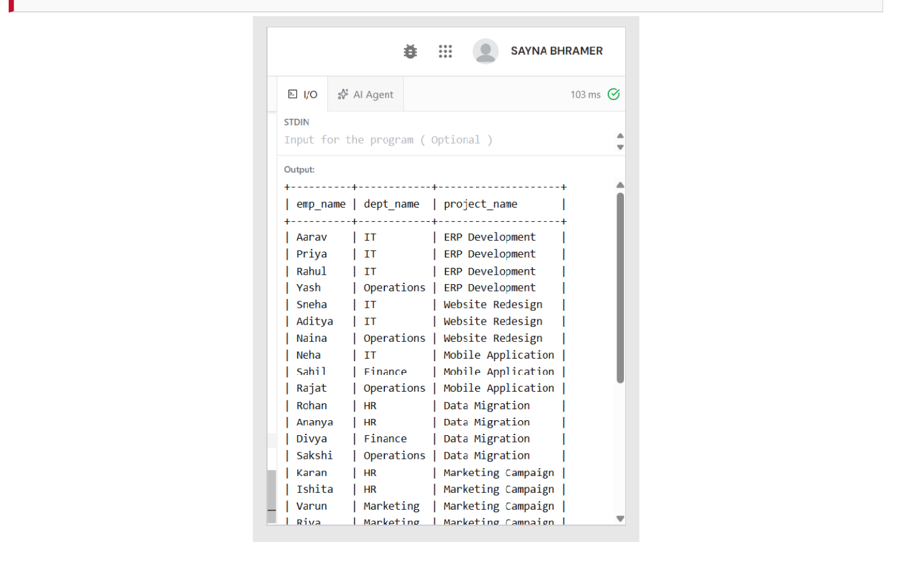
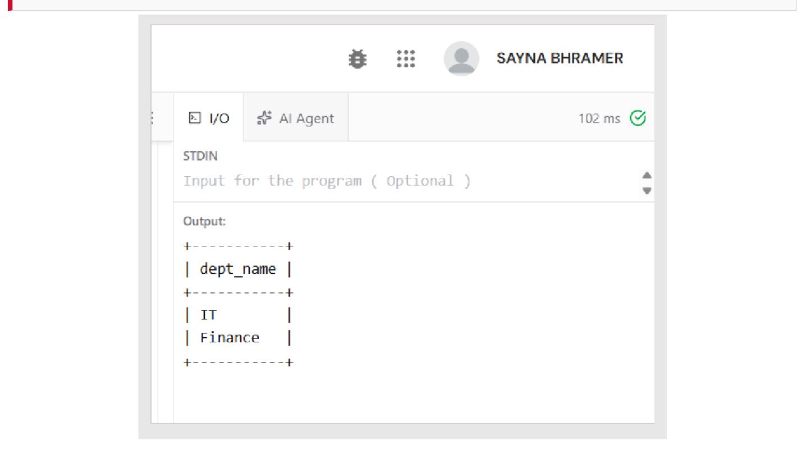
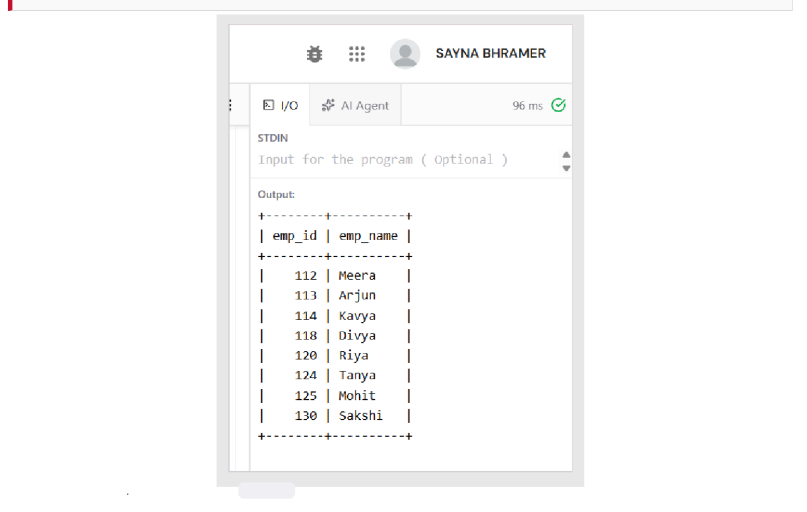
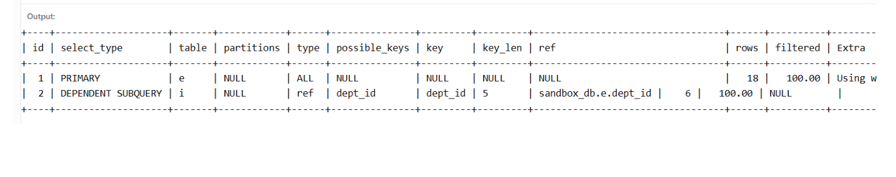
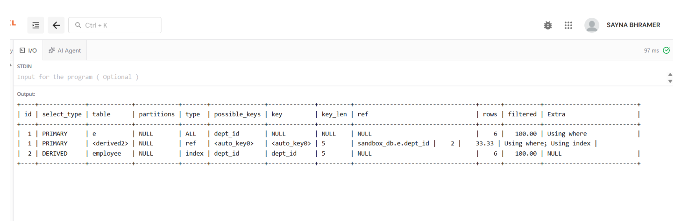

# Experiment 04: Complex SQL Queries — Joins, Subqueries & Execution Plans

## Aim
Using the Employee schema from Experiment 3, to write queries using **INNER JOIN**, **LEFT JOIN**, **self-join**, a **3-way join**, **correlated subqueries**, **EXISTS**, and **simulated INTERSECT and EXCEPT**, and to compare query execution plans using **EXPLAIN**.

---

## Software / Tools Required
| Component | Specification |
| :--- | :--- |
| **DBMS** | MySQL Server 8.0 (Community Edition) |
| **Query Editor** | Online MySQL compiler / MySQL Workbench 8.0 |
| **Operating System** | Windows 11 |
| **Language** | SQL (DDL, DML, DQL) |
| **Plan Analysis** | EXPLAIN / EXPLAIN FORMAT=TREE |

---

## Theory
- **Joins**:
  - INNER JOIN: Returns rows that match in both tables.
  - LEFT (OUTER) JOIN: Returns all rows of the left table, with NULLs where there is no match.
  - SELF JOIN: A table joined with an alias of itself (e.g., employee to reporting manager).
  - Multi-way JOIN: A chain of joins across 3 or more tables (Employee $\\times$ Department $\\times$ Project).
- **Subqueries**: A non-correlated subquery evaluates once. A correlated subquery refers to an outer query column and re-evaluates per row. EXISTS returns true immediately upon finding a matching row, making it efficient and NULL-safe.
- **Set Operations**: Simulated using IN/EXISTS (intersection) and NOT IN/LEFT JOIN ... IS NULL (difference).
- **Execution Plans**: EXPLAIN shows the query optimizer plan: select_type (SIMPLE, PRIMARY, SUBQUERY, DEPENDENT SUBQUERY, DERIVED), access type (ALL, 
ef, eq_ref, const), and rows examined.

---

## SQL Code
The complete query scripts are available in [experiment04.sql](./experiment04.sql).

---

## Procedure & Queries Executed

### Q4.1: INNER JOIN — Employee with Department Name
`sql
SELECT e.emp_name, d.dept_name
FROM employee e
INNER JOIN department d
ON e.dept_id = d.dept_id;
`
**Output Screenshot:**

---

### Q4.2: LEFT JOIN — Every Department with its Employees
`sql
SELECT d.dept_name, e.emp_name
FROM department d
LEFT JOIN employee e
ON d.dept_id = e.dept_id;
`
**Output Screenshot:**

---

### Q4.3: SELF JOIN — Employee and Reporting Manager
`sql
SELECT e.emp_name AS Employee, 
       m.emp_name AS Manager
FROM employee e
LEFT JOIN employee m
ON e.manager_id = m.emp_id;
`
**Output Screenshot:**

---

### Q4.4: 3-Way JOIN — Employee × Department × Project
`sql
SELECT e.emp_name, d.dept_name, p.project_name
FROM works_on w
INNER JOIN employee e ON w.emp_id = e.emp_id
INNER JOIN department d ON e.dept_id = d.dept_id
INNER JOIN project p ON w.project_id = p.project_id
ORDER BY p.project_id, e.emp_id;
`
**Output Screenshot:**

---

### Q4.5: Correlated Subquery — Employees earning above their department average
`sql
SELECT e.emp_name, e.dept_id, e.salary
FROM employee e
WHERE e.salary > (
    SELECT AVG(i.salary)
    FROM employee i
    WHERE i.dept_id = e.dept_id
);
`
**Output Screenshot:**

---

### Q4.6: EXISTS — Departments having at least one employee earning above ₹70,000
`sql
SELECT d.dept_name
FROM department d
WHERE EXISTS (
    SELECT 1
    FROM employee e
    WHERE e.dept_id = d.dept_id
      AND e.salary > 70000
);
`
**Output Screenshot:**

---

### Q4.7: Simulated INTERSECT — IT employees who also work on ERP Development
`sql
SELECT e.emp_id, e.emp_name
FROM employee e
WHERE e.dept_id = 1
  AND e.emp_id IN (
      SELECT w.emp_id
      FROM works_on w
      JOIN project p ON w.project_id = p.project_id
      WHERE p.project_name = 'ERP Development'
  );
`
**Output Screenshot:**

---

### Q4.8: Simulated EXCEPT — High earners (> ₹60,000) who are NOT in IT
`sql
SELECT emp_id, emp_name
FROM employee
WHERE salary > 60000
  AND emp_id NOT IN (
      SELECT emp_id
      FROM employee
      WHERE dept_id = 1
  );
`
**Output Screenshot:**

---

### Q4.9: EXPLAIN — Execution plan of the correlated subquery
`sql
EXPLAIN
SELECT e.emp_name, e.dept_id, e.salary
FROM employee e
WHERE e.salary > (
    SELECT AVG(i.salary)
    FROM employee i
    WHERE i.dept_id = e.dept_id
);
`
**Output Screenshot:**

---

### Q4.10: EXPLAIN — Same result rewritten as a JOIN with a derived table
`sql
EXPLAIN
SELECT e.emp_name, e.dept_id, e.salary
FROM employee e
JOIN (
    SELECT dept_id, AVG(salary) AS avg_sal
    FROM employee
    GROUP BY dept_id
) a ON e.dept_id = a.dept_id
WHERE e.salary > a.avg_sal;
`
**Output Screenshot:**

---

## Execution Plan Comparison
| Aspect | Correlated Subquery (Q4.9) | JOIN + Derived Table (Q4.10) |
| :--- | :--- | :--- |
| **select_type** | PRIMARY + DEPENDENT SUBQUERY | PRIMARY + DERIVED |
| **Inner Work** | Re-evaluated for each outer row (\\times$) | Averages computed once (5 groups) |
| **Scalability** | Cost grows $\\approx O(n^2)$ on large tables | Cost grows $\\approx O(n) + \\text{join}$ |
| **Verdict** | Readable, fine for small datasets | Preferred for large production tables |

---

## Result / Conclusion
All join types, subqueries, and simulated set operations ran and returned expected results:
- The self-join correctly reconstructed the 3-level reporting hierarchy.
- The 3-way join proved that projects span departments (e.g., Yash from Operations assigned to ERP Development).
- EXISTS returned IT and Finance as the departments with an employee earning $> \\text{₹}70,000$.
- Simulated EXCEPT returned 8 employees (the 11 high earners minus the 3 in IT).
- EXPLAIN verified that rewriting correlated subqueries as derived-table joins removes repeated executions, yielding superior scalability.
