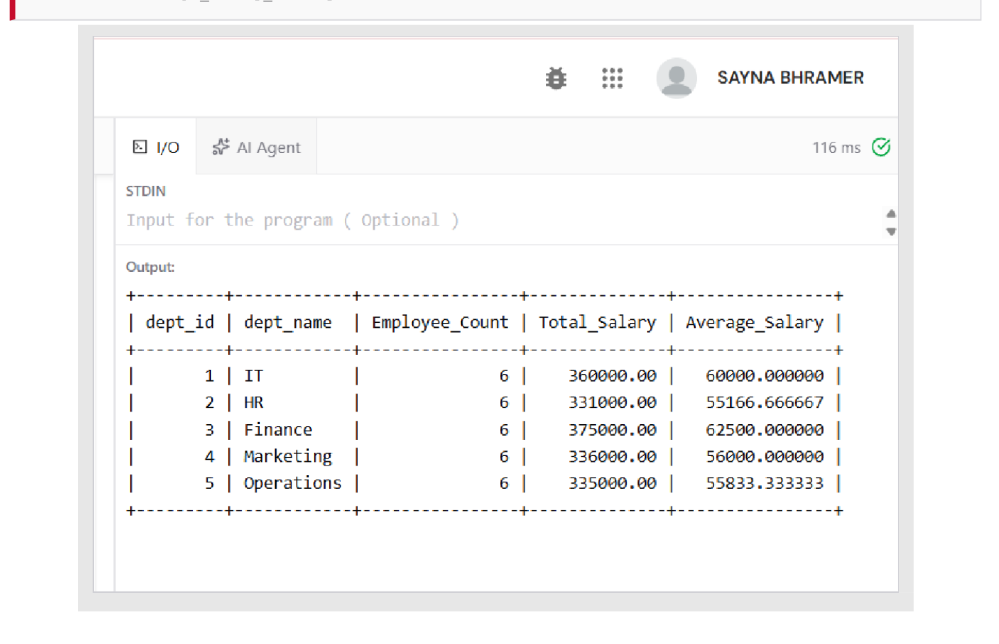
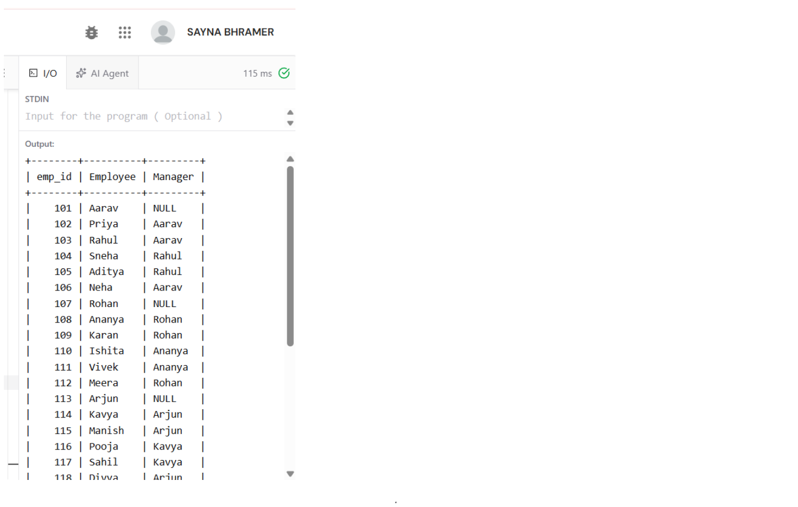
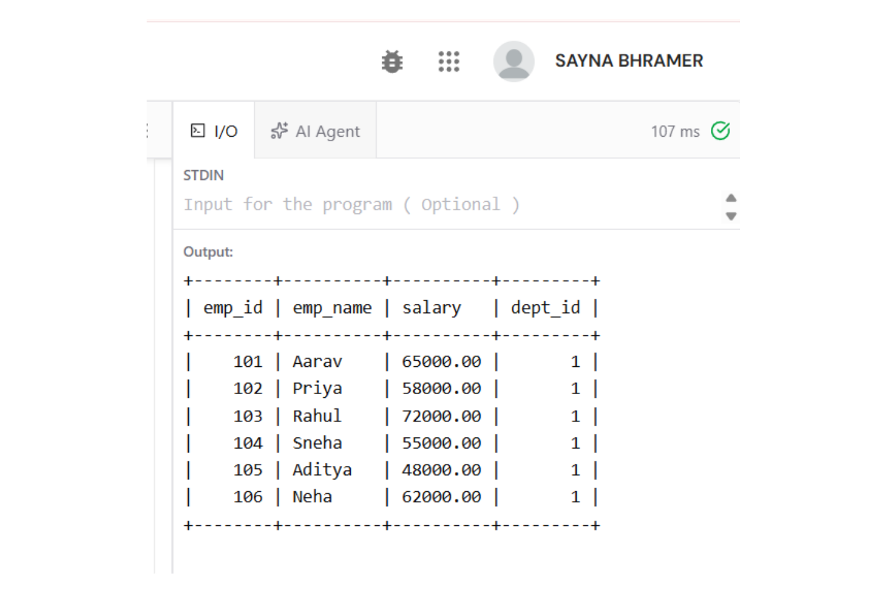
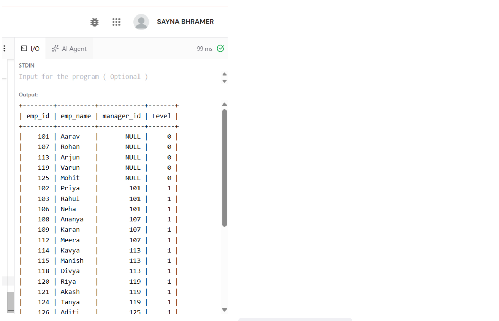

# Experiment 05: SQL Views and Recursive Common Table Expressions (CTE)

## Aim
To create SQL **views** for a department salary summary and the employee hierarchy, to test the **updatability of views**, and to implement a **recursive Common Table Expression (CTE)** that displays the complete reporting chain of every employee.

---

## Software / Tools Required
| Component | Specification |
| :--- | :--- |
| **DBMS** | MySQL Server 8.0 (Community Edition) |
| **Query Editor** | Online MySQL compiler / MySQL Workbench 8.0 |
| **Operating System** | Windows 11 |
| **Language** | SQL (DDL, DML, DQL) |
| **Feature Needed** | WITH RECURSIVE (MySQL $\\ge$ 8.0) |

---

## Theory
- **SQL Views**: A view is a named, stored query acting as a virtual table. Views provide abstraction (hiding joins), security (restricting rows/columns), and logical data independence.
- **Updatable Views**: A view can support INSERT, UPDATE, and DELETE only if each view row maps to exactly one base table row. A view becomes read-only if it contains aggregates, GROUP BY, HAVING, DISTINCT, UNION, or temp tables.
- **WITH CHECK OPTION**: Prevents modifications through a view that would produce rows that do not satisfy the view's WHERE filter.
- **Recursive CTE**: WITH RECURSIVE defines a self-referencing query comprising:
  1. *Anchor Member*: Initial seed rows (e.g., top-level managers with manager_id IS NULL).
  2. *Recursive Member*: Joins back to the base table to fetch subsequent hierarchy tiers.
  3. Recursion terminates automatically when an iteration returns empty.

---

## Database / Table Structure
Uses base tables employee and department from Experiment 3:
| Object | Type | Based On | Updatable? |
| :--- | :--- | :--- | :--- |
| dept_salary_summary | View | department $\\leftouterjoin$ employee, GROUP BY | No (aggregates) |
| employee_hierarchy | View | employee (self-join) $\\bowtie$ department | Partially (key-preserved columns) |
| it_employees | View + CHECK OPTION | employee WHERE dept_id = 1 | Yes |
| 
eporting_chain | Recursive CTE | employee.manager_id $\\rightarrow$ emp_id | — (Query-scoped) |

---

## SQL Code
The complete view and CTE scripts are available in [experiment05.sql](./experiment05.sql).

---

## Procedure & Queries Executed

### Q5.1: View 1 — Department Salary Summary
`sql
CREATE VIEW dept_salary_summary AS 
SELECT d.dept_id, 
       d.dept_name, 
       COUNT(e.emp_id) AS Employee_Count, 
       SUM(e.salary) AS Total_Salary, 
       AVG(e.salary) AS Average_Salary 
FROM department d 
LEFT JOIN employee e ON d.dept_id = e.dept_id 
GROUP BY d.dept_id, d.dept_name; 

SELECT * FROM dept_salary_summary;
`
**Output Screenshot:**

---

### Q5.2: View 2 — Employee Hierarchy (Employee $\\rightarrow$ Manager)
`sql
CREATE VIEW employee_hierarchy AS 
SELECT e.emp_id, 
       e.emp_name AS Employee, 
       m.emp_name AS Manager, 
       d.dept_name AS Department 
FROM employee e 
LEFT JOIN employee m ON e.manager_id = m.emp_id 
INNER JOIN department d ON e.dept_id = d.dept_id; 

SELECT * FROM employee_hierarchy;
`
**Output Screenshot:**

---

### Q5.3: Updatable View — Simple View with WITH CHECK OPTION
`sql
CREATE VIEW it_employees AS 
SELECT emp_id, emp_name, salary, dept_id 
FROM employee 
WHERE dept_id = 1 
WITH CHECK OPTION; 

-- Update through view (propagates to base table)
UPDATE it_employees SET salary = salary + 2000 WHERE emp_id = 105; 
SELECT * FROM it_employees; 
SELECT emp_id, emp_name, salary FROM employee WHERE emp_id = 105; 

-- Revert value
UPDATE it_employees SET salary = salary - 2000 WHERE emp_id = 105;
`
**Output Screenshot:**

---

### Q5.4: Recursive CTE — Full Reporting Chain from Department Heads
`sql
WITH RECURSIVE reporting_chain AS ( 
    -- anchor: top-level managers
    SELECT emp_id, emp_name, manager_id, 
           1 AS level, 
           CAST(emp_name AS CHAR(200)) AS chain 
    FROM employee 
    WHERE manager_id IS NULL 
    
    UNION ALL 
    
    -- recursive step: direct reports of previous level 
    SELECT e.emp_id, e.emp_name, e.manager_id, 
           rc.level + 1, 
           CONCAT(rc.chain, ' -> ', e.emp_name) 
    FROM employee e 
    INNER JOIN reporting_chain rc ON e.manager_id = rc.emp_id 
) 
SELECT emp_id, emp_name, level, chain AS Reporting_Chain 
FROM reporting_chain 
ORDER BY chain;
`
**Output Screenshot:**

---

## Result / Conclusion
- Both views were created and queried successfully.
- dept_salary_summary indicated Finance has the highest department payroll (₹3,75,000) and HR has the lowest average (₹55,166.67).
- Updatability verified that changes to it_employees modified underlying base rows in employee, while WITH CHECK OPTION protected integrity.
- The recursive CTE mapped the 3-level tree hierarchy across all 30 employees cleanly (e.g., Arjun -> Kavya -> Pooja).
