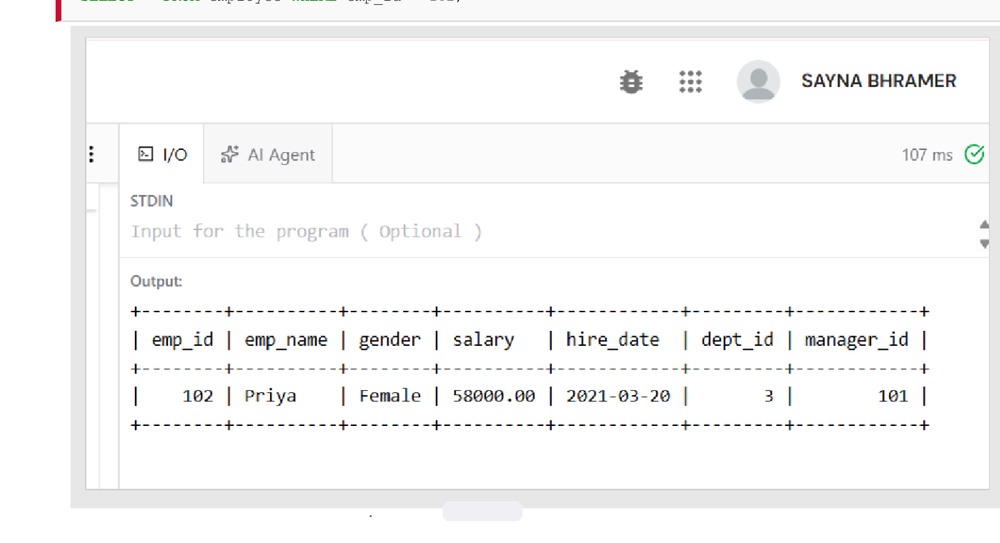
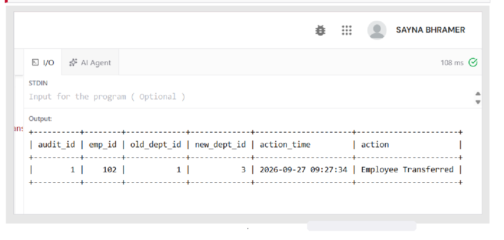
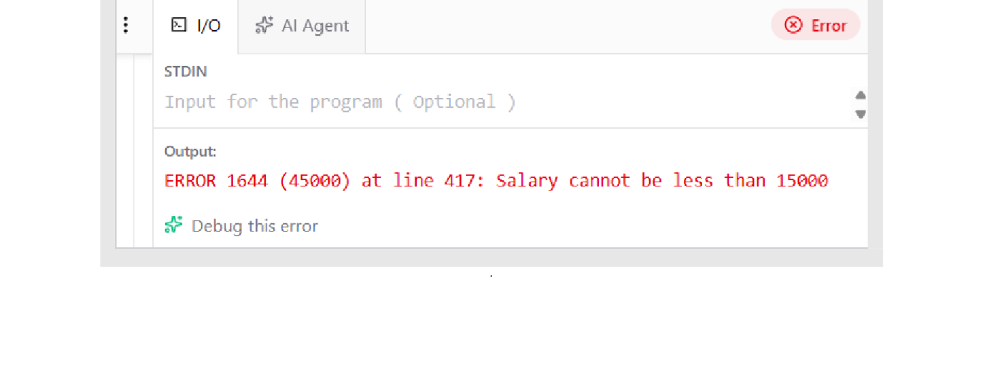
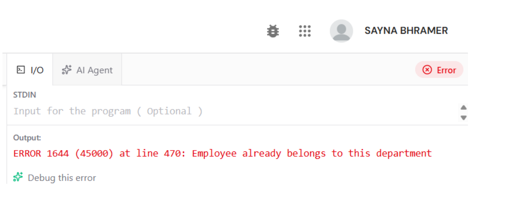
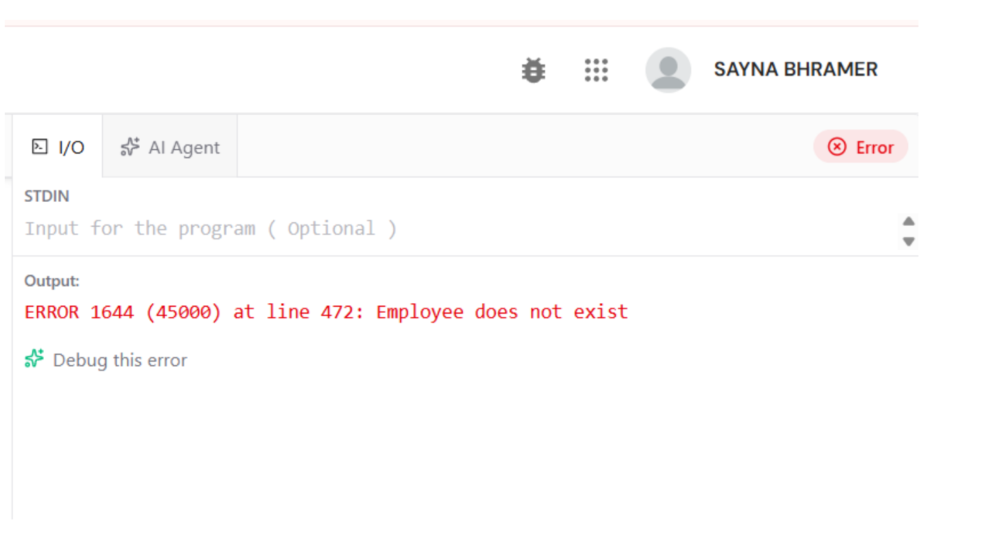
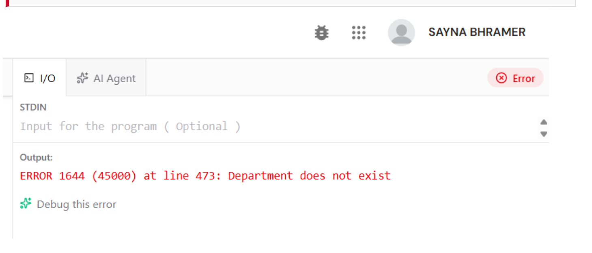
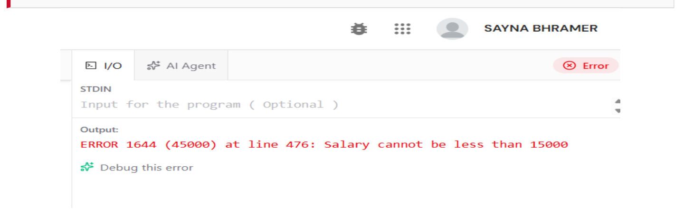

# Experiment 06: Stored Procedures, Error Handling & Triggers

## Aim
To create a stored procedure 	ransfer_employee(emp_id, new_dept_id) with input validation and error handling, to implement triggers for salary validation and audit logging, and to test normal and edge cases.

---

## Software / Tools Required
| Component | Specification |
| :--- | :--- |
| **DBMS** | MySQL Server 8.0 (Community Edition) |
| **Query Editor** | Online MySQL compiler / MySQL Workbench 8.0 |
| **Operating System** | Windows 11 |
| **Language** | SQL (DDL, DML, DQL) |
| **Features Used** | Stored Procedures, SIGNAL/RESIGNAL, Handlers, Triggers |

---

## Theory
- **Stored Procedures**: Named blocks of SQL statements stored on the database server, executed using CALL. They encapsulate business logic, optimize network round-trips, and provide secure access control.
- **Error Handling**:
  - SIGNAL SQLSTATE '45000' SET MESSAGE_TEXT = ...: Raises custom errors (Error 1644).
  - DECLARE EXIT HANDLER FOR SQLEXCEPTION: Intercepts runtime errors, handles cleanup/rollback, and ensures atomic transactions.
  - START TRANSACTION ... COMMIT / ROLLBACK: Guarantees ACID transaction semantics.
- **Triggers**: Automated routines invoked on DML (INSERT, UPDATE, DELETE).
  - BEFORE triggers validate and enforce domain constraints before data changes.
  - AFTER triggers record audit logs (OLD reflects pre-change state, NEW reflects post-change).

---

## Database / Table Structure
Uses employee and department from Experiment 3, along with a dedicated audit table:

### Table: employee_audit
| Column | Data Type | Constraint | Description |
| :--- | :--- | :--- | :--- |
| udit_id | INT | PK, AUTO_INCREMENT | Log entry sequence number |
| emp_id | INT | NOT NULL | Employee identifier affected |
| old_dept_id | INT | — | Prior department |
| 
ew_dept_id | INT | — | Updated department |
| ction_time | DATETIME | DEFAULT CURRENT_TIMESTAMP | Timestamp of event |
| ction | VARCHAR(50) | — | Description of change |

### Procedures and Triggers Created:
| Object | Type | Timing / Event | Purpose |
| :--- | :--- | :--- | :--- |
| 	ransfer_employee | Procedure | CALL | Validates & transfers employee between departments |
| 	rg_salary_check_insert | Trigger | BEFORE INSERT | Rejects salary < ₹15,000 |
| 	rg_salary_check_update | Trigger | BEFORE UPDATE | Rejects salary < ₹15,000 |
| 	rg_audit_dept_change | Trigger | AFTER UPDATE | Logs department changes automatically |

---

## SQL Code
The complete stored procedure and trigger definitions are available in [experiment06.sql](./experiment06.sql).

---

## Procedure & Test Cases Executed

### Q6.1: Valid Transfer — Move Priya (102) from IT (1) to Finance (3)
`sql
CALL transfer_employee(102, 3);
SELECT * FROM employee WHERE emp_id = 102;
`
**Output Screenshot:**

---

### Q6.2: Audit Trigger Fired Automatically
`sql
SELECT * FROM employee_audit;
`
**Output Screenshot:**

---

### Q6.3: Salary Trigger — Update below minimum blocked
`sql
UPDATE employee SET salary = 12000 WHERE emp_id = 105;
`
**Output Screenshot:**

---

### Q6.4: Edge Case — Employee does not exist
`sql
CALL transfer_employee(999, 2);
-- ERROR 1644 (45000): Employee does not exist
`
**Output Screenshot:**

---

### Q6.5: Edge Case — Department does not exist
`sql
CALL transfer_employee(101, 9);
-- ERROR 1644 (45000): Department does not exist
`
**Output Screenshot:**

---

### Q6.6: Edge Case — Transfer to same department
`sql
CALL transfer_employee(103, 1);
-- ERROR 1644 (45000): Employee already belongs to this department
`
**Output Screenshot:**

---

### Q6.7: Edge Case — INSERT with invalid salary
`sql
INSERT INTO employee VALUES (131, 'Test', 'Male', 10000.00, '2026-09-27', 1, 101);
-- ERROR 1644 (45000): Salary cannot be less than 15000
`
**Output Screenshot:**

---

## Test Results Matrix
| Test Case | Input | Expected Behavior | Status |
| :--- | :--- | :--- | :--- |
| **Valid transfer** | (102, 3) | Row updated + audit entry created | ✔ Pass |
| **Salary below minimum** | salary = 12000 | ERROR 1644: Salary cannot be less than 15000 | ✔ Pass |
| **Unknown employee** | (999, 2) | ERROR 1644: Employee does not exist | ✔ Pass |
| **Unknown department** | (101, 9) | ERROR 1644: Department does not exist | ✔ Pass |
| **Same department** | (103, 1) | ERROR 1644: Employee already belongs to this department | ✔ Pass |
| **Invalid INSERT salary** | 10000 | ERROR 1644: Salary cannot be less than 15000 | ✔ Pass |

---

## Result / Conclusion
The stored procedure moved employee 102 (Priya) from IT to Finance, and the AFTER UPDATE trigger logged the audit record (1 -> 3, 'Employee Transferred'). The BEFORE triggers blocked sub-minimum salaries below ₹15,000 via custom SQLSTATE 45000 exceptions without corrupting state. All edge cases successfully raised expected exceptions.
