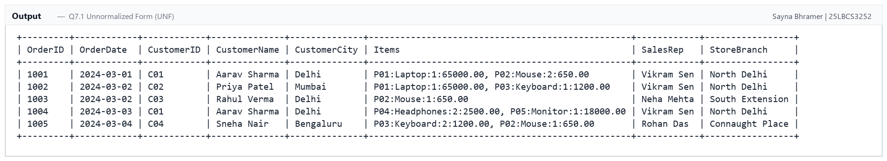
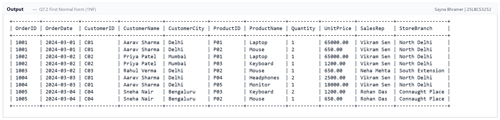
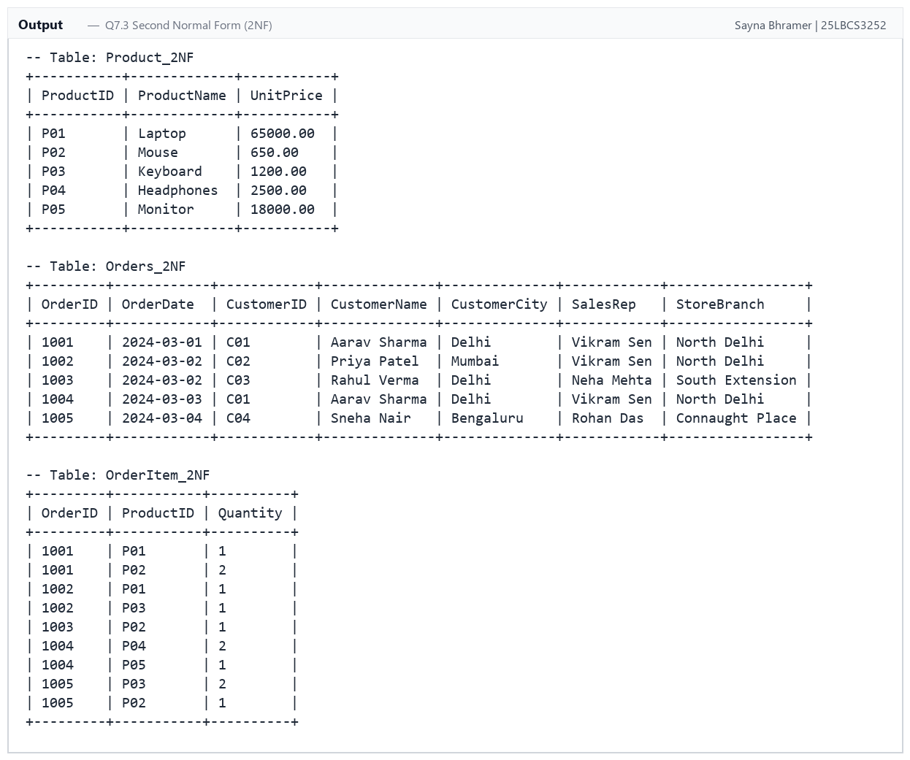
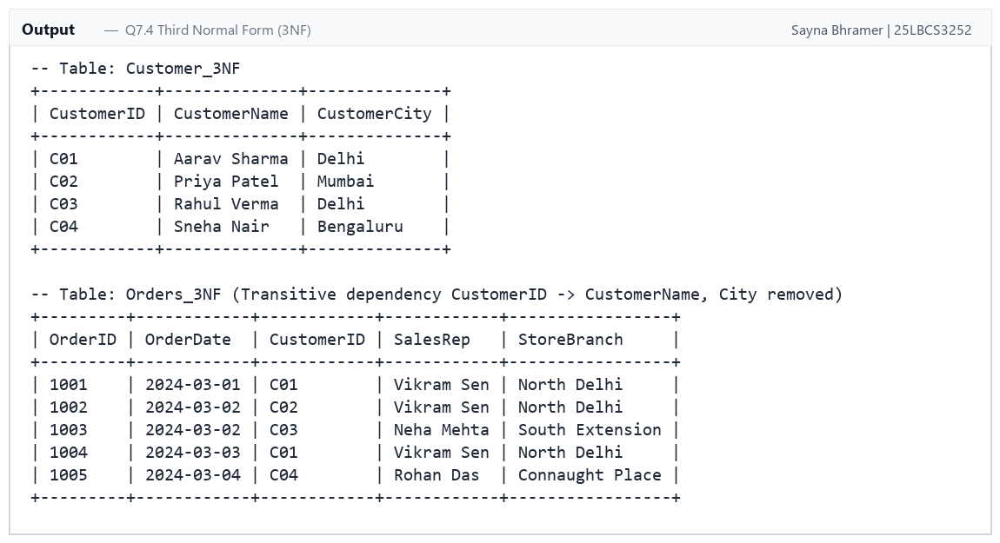
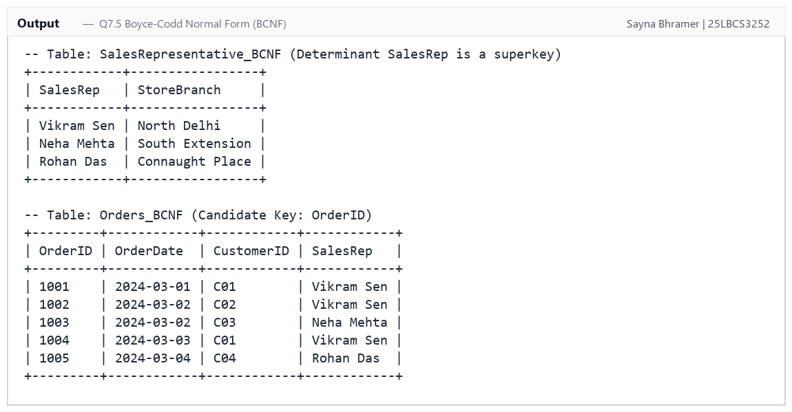
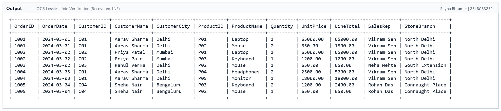

# Experiment 07: Database Normalization (UNF to 1NF, 2NF, 3NF, and BCNF)

## Aim
To normalize a denormalized **Sales/Order** dataset from **Unnormalized Form (UNF)** through **First Normal Form (1NF)**, **Second Normal Form (2NF)**, **Third Normal Form (3NF)**, and **Boyce-Codd Normal Form (BCNF)**, systematically identifying functional dependencies, eliminating insertion, update, and deletion anomalies, and verifying both lossless join and dependency preservation.

---

## Software / Tools Required
| Component | Specification |
| :--- | :--- |
| **DBMS** | MySQL Server 8.0 / 9.x (Community Edition) |
| **Query Editor** | Online MySQL Compiler / MySQL Workbench 8.0 |
| **Operating System** | Windows 11 |
| **Language** | SQL (DDL, DML, DQL) |

---

## Theory & Normal Forms Hierarchy

### 1. The Normalization Journey
`
[ UNF: Unnormalized Form ]
       │  (Eliminate multi-valued/repeating groups; ensure atomic attributes)
       ▼
[ 1NF: First Normal Form ]
       │  (Eliminate partial dependencies on candidate key)
       ▼
[ 2NF: Second Normal Form ]
       │  (Eliminate transitive dependencies on non-key attributes)
       ▼
[ 3NF: Third Normal Form ]
       │  (Eliminate non-trivial FDs where determinant is not a superkey)
       ▼
[ BCNF: Boyce-Codd Normal Form ]
`

### 2. Modification Anomalies in Denormalized Relations
- **Insertion Anomaly:** Cannot record a new customer or product until an order has been placed.
- **Update Anomaly:** Updating a customer's city or a product's price requires updating multiple redundant rows; failure to update all causes data inconsistency.
- **Deletion Anomaly:** Deleting an order accidentally deletes all details of the customer or product if it was their only recorded transaction.

### 3. Functional Dependencies (FDs) Identified
1. (OrderID, ProductID) -> Quantity *(Full dependency on composite key)*
2. ProductID -> ProductName, UnitPrice *(Partial dependency on composite key)*
3. OrderID -> OrderDate, CustomerID, SalesRep, StoreBranch *(Partial dependency on composite key)*
4. CustomerID -> CustomerName, CustomerCity *(Transitive dependency via OrderID)*
5. SalesRep -> StoreBranch *(Transitive dependency via OrderID; non-superkey determinant)*

---

## Step-by-Step Normalization Process

### Step 1: Unnormalized Form (UNF)
The original relation contains non-atomic cells where multiple product line items (ProductID:ProductName:Qty:UnitPrice) are stored inside a single text field per order.

**Output Screenshot:**

---

### Step 2: First Normal Form (1NF)
- **Transformation:** Repeating groups are flattened so every attribute contains only atomic (indivisible) values.
- **Candidate Key:** (OrderID, ProductID)
- **Violation:** 
  - ProductID -> ProductName, UnitPrice depends only on a part of the primary key (**Partial Dependency**).
  - OrderID -> CustomerName, SalesRep, ... depends only on OrderID (**Partial Dependency**).

**Output Screenshot:**

---

### Step 3: Second Normal Form (2NF)
- **Transformation:** Decompose the relation to remove partial functional dependencies.
- **Decomposed Relations:**
  1. Product_2NF (ProductID, ProductName, UnitPrice) — PK: ProductID
  2. Orders_2NF (OrderID, OrderDate, CustomerID, CustomerName, CustomerCity, SalesRep, StoreBranch) — PK: OrderID
  3. OrderItem_2NF (OrderID, ProductID, Quantity) — Composite PK: (OrderID, ProductID)

**Output Screenshot:**

---

### Step 4: Third Normal Form (3NF)
- **Rule:** A relation is in 3NF if it is in 2NF and has **no transitive dependencies** of non-prime attributes on a candidate key.
- **Violation in Orders_2NF:**
  - OrderID -> CustomerID and CustomerID -> CustomerName, CustomerCity. Therefore, OrderID -> CustomerName, CustomerCity transitively.
- **Transformation:** Extract Customer into its own entity:
  1. Customer_3NF (CustomerID, CustomerName, CustomerCity) — PK: CustomerID
  2. Orders_3NF (OrderID, OrderDate, CustomerID, SalesRep, StoreBranch) — PK: OrderID, FK: CustomerID
  3. Product_3NF (ProductID, ProductName, UnitPrice) — PK: ProductID
  4. OrderItem_3NF (OrderID, ProductID, Quantity) — PK: (OrderID, ProductID)

**Output Screenshot:**

---

### Step 5: Boyce-Codd Normal Form (BCNF)
- **Rule:** A relation is in BCNF if for every non-trivial functional dependency  \\rightarrow Y$, the determinant $ is a **superkey**.
- **Violation in Orders_3NF:**
  - Each sales representative belongs to a specific store branch (SalesRep -> StoreBranch).
  - Here, SalesRep is a determinant, but SalesRep is **not** a candidate key of Orders_3NF (the candidate key is OrderID).
- **Transformation:** Decompose Orders_3NF into:
  1. SalesRepresentative_BCNF (SalesRep, StoreBranch) — PK: SalesRep
  2. Orders_BCNF (OrderID, OrderDate, CustomerID, SalesRep) — PK: OrderID, FK: SalesRep, FK: CustomerID
  3. Customer_BCNF (CustomerID, CustomerName, CustomerCity) — PK: CustomerID
  4. Product_BCNF (ProductID, ProductName, UnitPrice) — PK: ProductID
  5. OrderItem_BCNF (OrderID, ProductID, Quantity) — PK: (OrderID, ProductID)

**Output Screenshot:**

---

### Step 6: Lossless Join & Dependency Verification
Reconstructing the original relation by joining the 5 BCNF tables on foreign keys demonstrates that no spurious rows are created (**Lossless Join Property**):

`sql
SELECT 
    o.OrderID, o.OrderDate, c.CustomerID, c.CustomerName, c.CustomerCity,
    p.ProductID, p.ProductName, oi.Quantity, p.UnitPrice,
    (oi.Quantity * p.UnitPrice) AS LineTotal,
    sr.SalesRep, sr.StoreBranch
FROM Orders_BCNF o
JOIN Customer_BCNF c ON o.CustomerID = c.CustomerID
JOIN SalesRepresentative_BCNF sr ON o.SalesRep = sr.SalesRep
JOIN OrderItem_BCNF oi ON o.OrderID = oi.OrderID
JOIN Product_BCNF p ON oi.ProductID = p.ProductID
ORDER BY o.OrderID, p.ProductID;
`

**Output Screenshot:**

---

## Result / Conclusion
1. The denormalized Sales dataset was successfully transitioned from **UNF** to **1NF**, **2NF**, **3NF**, and **BCNF**.
2. **Partial dependencies** on the composite key (OrderID, ProductID) were eliminated in 2NF.
3. **Transitive dependencies** (CustomerID -> CustomerName, CustomerCity) were eliminated in 3NF.
4. The subtle non-superkey dependency (SalesRep -> StoreBranch) was decoupled in BCNF, achieving mathematical purity without data redundancy.
5. Verification queries confirmed the decomposition is **lossless** and preserves all enterprise integrity constraints.
