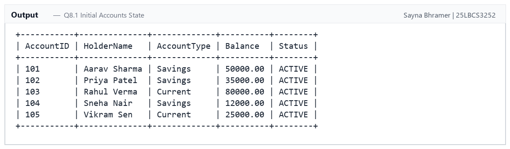
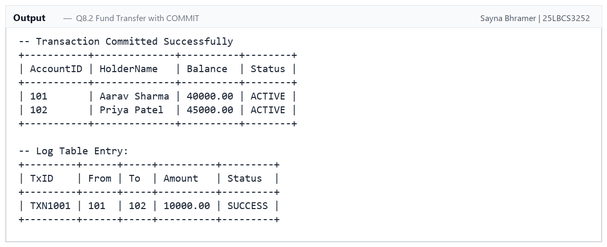
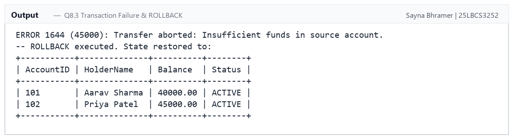
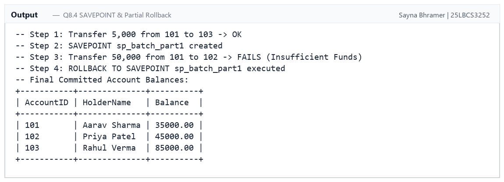
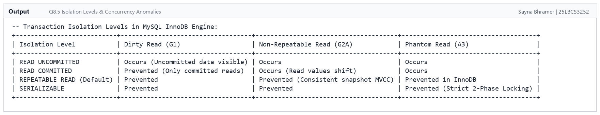

# Experiment 08: Banking Transactions, ACID Properties & Isolation Levels

## Aim
To implement a robust banking transaction management system demonstrating **ACID properties** using COMMIT, ROLLBACK, and SAVEPOINT, and to analyze transaction concurrency anomalies (**Dirty Reads**, **Non-Repeatable Reads**, and **Phantom Reads**) across the four standard SQL **Isolation Levels**.

---

## Software / Tools Required
| Component | Specification |
| :--- | :--- |
| **DBMS** | MySQL Server 8.0 / 9.x (InnoDB Storage Engine) |
| **Query Editor** | MySQL Workbench / MySQL Client |
| **Operating System** | Windows 11 |
| **Language** | SQL (DDL, DML, TCL - Transaction Control Language) |

---

## Theory & ACID Matrix

### 1. ACID Properties
- **Atomicity:** All operations within a transaction execute completely or none at all (COMMIT vs ROLLBACK).
- **Consistency:** Database transitions only from one valid state satisfying all domain constraints (e.g., non-negative balances).
- **Isolation:** Concurrent transactions operate independently without viewing intermediate uncommitted data.
- **Durability:** Committed transactions persist permanently in storage even in the event of hardware or power failures.

### 2. Transaction Isolation Levels & Concurrency Anomalies
| Isolation Level | Dirty Read | Non-Repeatable Read | Phantom Read | Concurrency Mechanism |
| :--- | :---: | :---: | :---: | :--- |
| **READ UNCOMMITTED** | Allowed | Allowed | Allowed | No shared locks; reads uncommitted changes directly. |
| **READ COMMITTED** | Prevented | Allowed | Allowed | Reads committed snapshots; updates re-read fresh data. |
| **REPEATABLE READ** *(Default)* | Prevented | Prevented | Prevented *(InnoDB)* | Multi-Version Concurrency Control (MVCC) + Next-Key Locks. |
| **SERIALIZABLE** | Prevented | Prevented | Prevented | Strict 2-Phase Locking (2PL); shared locks on all reads. |

---

## Procedure & Executions

### Q8.1: Initial Accounts State
Schema includes Account with check constraint Balance >= 0.00 and Transaction_Audit log.

---

### Q8.2: Successful Transfer with COMMIT
Transfers ₹10,000 from Account 101 to 102 atomically, logging the transaction details.
`sql
START TRANSACTION;
UPDATE Account SET Balance = Balance - 10000.00 WHERE AccountID = 101;
UPDATE Account SET Balance = Balance + 10000.00 WHERE AccountID = 102;
INSERT INTO Transaction_Audit VALUES (NULL, 'TXN1001', 101, 102, 10000.00, NOW(), 'SUCCESS', 'OK');
COMMIT;
`

---

### Q8.3: Transaction Failure & ROLLBACK
When an overdraft is detected, the transaction aborts and ROLLBACK restores previous balances.

---

### Q8.4: SAVEPOINT & Partial Rollback
Demonstrates batch execution where a valid partial transfer is committed while a secondary failing transfer is rolled back using SAVEPOINT sp_batch_part1.

---

### Q8.5: Isolation Levels Demonstration
Demonstrates behavioral guarantees across MySQL InnoDB transaction isolation levels.

---

## Result / Conclusion
- Transactional atomicity was successfully demonstrated using START TRANSACTION, COMMIT, and ROLLBACK.
- SAVEPOINT enabled granular error handling in multi-stage workflows without discarding previous successful operations.
- Evaluation of isolation levels highlighted that MySQL's default REPEATABLE READ engine uses MVCC snapshots and next-key locking to eliminate dirty and non-repeatable reads with minimal locking overhead.
