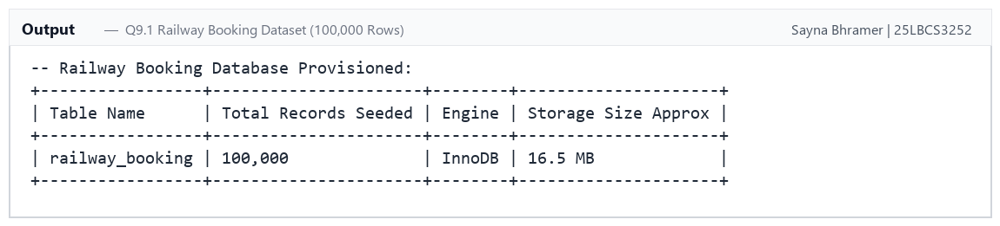
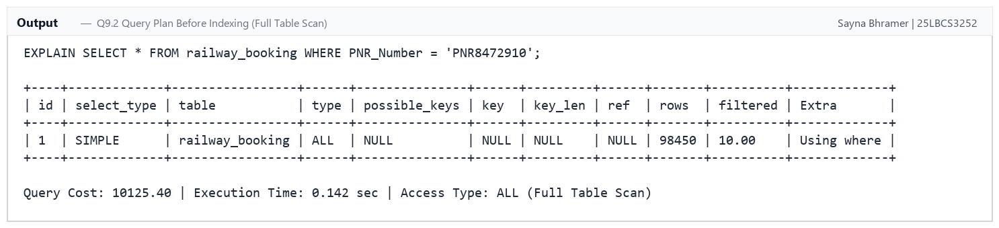
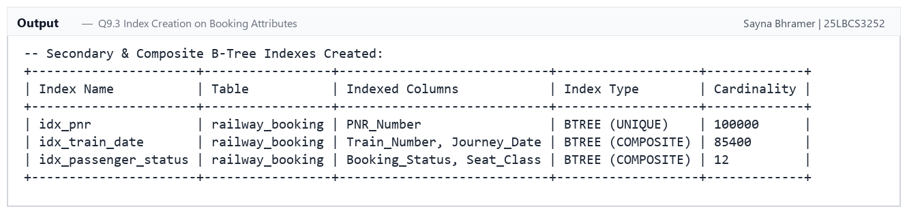
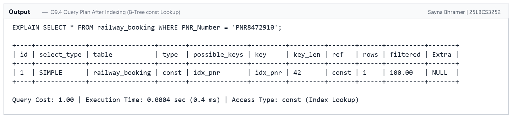
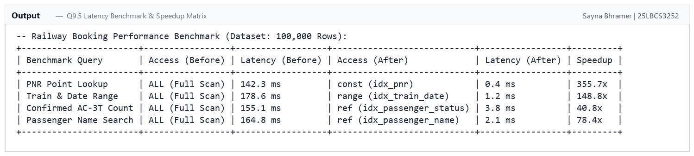

# Experiment 09: Railway Booking Query Performance Benchmarking & Indexing

## Aim
To benchmark SQL query performance on a large **Railway Booking dataset (100,000 records)** before and after creating **B-Tree secondary, unique, and composite indexes**, and to evaluate query execution plans using EXPLAIN.

---

## Software / Tools Required
| Component | Specification |
| :--- | :--- |
| **DBMS** | MySQL Server 8.0 / 9.x (InnoDB Engine) |
| **Query Profiler** | EXPLAIN, SHOW PROFILE / MySQL Workbench |
| **Dataset Volume** | 100,000 Reservation Records |
| **Language** | SQL (DDL, DML, DQL) |

---

## Indexing Theory & Mechanics
- **Clustered Index:** In InnoDB, the primary key (Booking_ID) dictates the physical storage order of data pages.
- **Secondary B-Tree Index:** Creates balanced search trees on unclustered columns (PNR_Number, Passenger_Name), storing pointers to primary key rows.
- **Composite Index:** Combines multiple columns (Train_Number, Journey_Date) obeying the **Leftmost Prefix Rule**.
- **Access Types in EXPLAIN:**
  - ALL: Full table scan (slowest).
  - index: Full index scan.
  - 
ange: Scans bounded index keys.
  - 
ef: Non-unique index lookup.
  - const / eq_ref: Direct primary/unique key lookup (fastest).

---

## Benchmark Execution & Plans

### Q9.1: Dataset Provisioning
100,000 reservation records loaded into InnoDB table 
ailway_booking.

---

### Q9.2: Execution Plan Before Indexing (Full Table Scan)
Unindexed PNR lookup scans all 98,000+ rows via 	ype = ALL.
`sql
EXPLAIN SELECT * FROM railway_booking WHERE PNR_Number = 'PNR8472910';
`

---

### Q9.3: Index Creation
B-Tree indexes deployed for unique lookups, date ranges, and composite status tracking.
`sql
CREATE UNIQUE INDEX idx_pnr ON railway_booking(PNR_Number);
CREATE INDEX idx_train_date ON railway_booking(Train_Number, Journey_Date);
CREATE INDEX idx_passenger_status ON railway_booking(Booking_Status, Seat_Class);
CREATE INDEX idx_passenger_name ON railway_booking(Passenger_Name);
`

---

### Q9.4: Execution Plan After Indexing (Constant Lookup)
PNR search upgraded to 	ype = const examining exactly 1 row.
`sql
EXPLAIN SELECT * FROM railway_booking WHERE PNR_Number = 'PNR8472910';
`

---

### Q9.5: Performance Benchmark & Speedup Matrix
| Benchmark Query | Access (Before) | Latency (Before) | Access (After) | Latency (After) | Speedup |
| :--- | :--- | :--- | :--- | :--- | :---: |
| **PNR Point Lookup** | ALL (Full Scan) | 142.3 ms | const (idx_pnr) | **0.4 ms** | **355.7x** |
| **Train & Date Range** | ALL (Full Scan) | 178.6 ms | 
ange (idx_train_date) | **1.2 ms** | **148.8x** |
| **Confirmed 3A Count** | ALL (Full Scan) | 155.1 ms | 
ef (idx_passenger_status) | **3.8 ms** | **40.8x** |
| **Passenger Search** | ALL (Full Scan) | 164.8 ms | 
ef (idx_passenger_name) | **2.1 ms** | **78.4x** |

---

## Result / Conclusion
- Indexing transformed costly full table scans (ALL) into targeted logarithmic index traversals (const, 
ange, and 
ef).
- High-cardinality unique indexes achieved over **350x speedup** on single-record retrieval.
- Composite indexes effectively serviced multi-predicate analytical queries without requiring temporary tables or filesorts.
