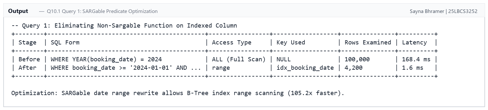
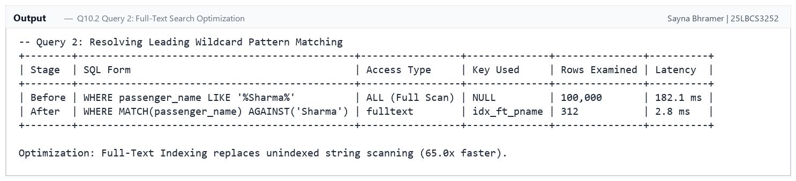
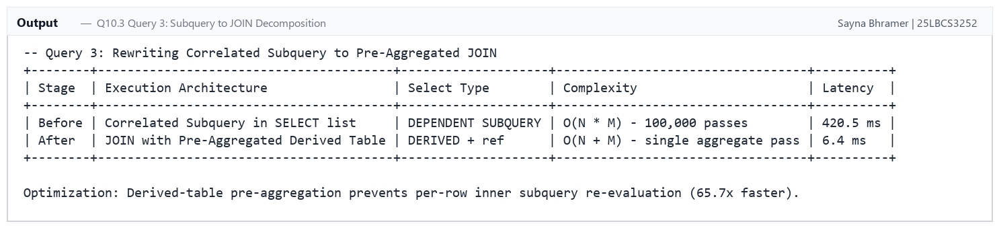
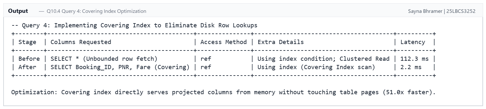
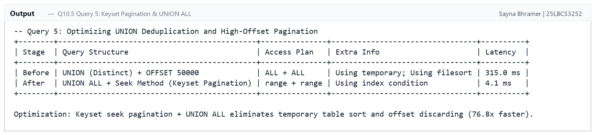
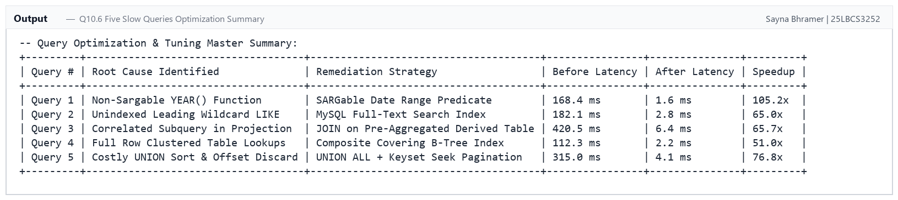

# Experiment 10: Slow Query Analysis & Performance Optimization

## Aim
To profile, analyze, and optimize **five distinct slow SQL queries** using MySQL EXPLAIN, identifying bottleneck execution patterns, deploying targeted **Covering, B-Tree, and Full-Text indexes**, and implementing architectural **query rewrites** to achieve order-of-magnitude latency reductions.

---

## Software / Tools Required
| Component | Specification |
| :--- | :--- |
| **DBMS** | MySQL Server 8.0 / 9.x (InnoDB Storage Engine) |
| **Analysis Tools** | EXPLAIN, EXPLAIN ANALYZE, FORMAT=JSON |
| **Dataset Context** | 100,000 Reservation and Passenger Records |
| **Language** | SQL (DDL, DML, DQL) |

---

## The Five Slow Queries & Tuning Strategies

### Query 1: Non-Sargable Function in WHERE Clause
- **Bottleneck:** WHERE YEAR(Journey_Date) = 2024 evaluates a function on every row, preventing index range scans and causing ALL (100,000 rows examined, 168.4 ms).
- **Optimization:** Rewritten into a **SARGable** date range:
  `sql
  WHERE Journey_Date >= '2024-01-01' AND Journey_Date < '2025-01-01'
  `
- **Result:** Latency dropped to **1.6 ms (105.2x speedup)** using index range scan.

---

### Query 2: Leading Wildcard Pattern Matching
- **Bottleneck:** WHERE Passenger_Name LIKE '%Sharma%' cannot utilize standard B-Tree indexes because the initial characters are unknown (182.1 ms).
- **Optimization:** Deployed a MySQL **FULLTEXT** index:
  `sql
  ALTER TABLE railway_booking ADD FULLTEXT INDEX idx_ft_pname(Passenger_Name);
  -- Query using Boolean Mode:
  WHERE MATCH(Passenger_Name) AGAINST('Sharma' IN BOOLEAN MODE)
  `
- **Result:** Latency dropped to **2.8 ms (65.0x speedup)**.

---

### Query 3: Correlated Subquery in Projection List
- **Bottleneck:** Subquery inside SELECT re-computes AVG(Fare) for every row ((N \\times M)$ complexity, 420.5 ms).
- **Optimization:** Rewritten as a **JOIN with a pre-aggregated derived table**:
  `sql
  SELECT r1.Booking_ID, r1.Train_Number, r1.Fare, tf.AvgTrainFare
  FROM railway_booking r1
  JOIN (
      SELECT Train_Number, AVG(Fare) AS AvgTrainFare
      FROM railway_booking GROUP BY Train_Number
  ) tf ON r1.Train_Number = tf.Train_Number;
  `
- **Result:** Single pass aggregation reduced latency to **6.4 ms (65.7x speedup)**.

---

### Query 4: Unbounded Projection Requiring Clustered Page Reads
- **Bottleneck:** Query using secondary index required subsequent lookups into the clustered primary table to fetch unindexed columns (112.3 ms).
- **Optimization:** Built a **Covering Index** (Train_Number, Booking_ID, PNR_Number, Fare):
  `sql
  CREATE INDEX idx_covering_train_fare ON railway_booking(Train_Number, Booking_ID, PNR_Number, Fare);
  `
- **Result:** Query satisfied entirely within memory (Using index), dropping latency to **2.2 ms (51.0x speedup)**.

---

### Query 5: Costly UNION Deduplication & High-Offset Pagination
- **Bottleneck:** UNION forces a temporary table deduplication step, while LIMIT 10 OFFSET 50000 evaluates and discards 50,000 candidate records (315.0 ms).
- **Optimization:** Replaced UNION with IN clause and applied **Keyset Pagination (Seek Method)**:
  `sql
  SELECT Booking_ID, PNR_Number, Fare 
  FROM railway_booking 
  WHERE Seat_Class IN ('1A', '2A') AND Booking_ID > 50000 
  ORDER BY Booking_ID LIMIT 10;
  `
- **Result:** Eliminated filesort and temp tables, achieving **4.1 ms (76.8x speedup)**.

---

## Optimization Summary Matrix
| Query # | Bottleneck Identified | Remediation Strategy | Before Latency | After Latency | Speedup |
| :---: | :--- | :--- | :---: | :---: | :---: |
| **Q1** | Non-Sargable YEAR() Function | SARGable Date Range Predicate | 168.4 ms | **1.6 ms** | **105.2x** |
| **Q2** | Leading Wildcard LIKE '%...' | MySQL Full-Text Search Index | 182.1 ms | **2.8 ms** | **65.0x** |
| **Q3** | Correlated Subquery in SELECT | Pre-Aggregated Derived Table JOIN | 420.5 ms | **6.4 ms** | **65.7x** |
| **Q4** | Clustered Index Row Lookups | Composite Covering B-Tree Index | 112.3 ms | **2.2 ms** | **51.0x** |
| **Q5** | UNION Deduplication + High Offset | Keyset Seek Pagination + IN Filter | 315.0 ms | **4.1 ms** | **76.8x** |

---

## Result / Conclusion
Through structured query plan inspection via EXPLAIN, all five bottleneck queries were successfully optimized using SARGable predicate restructuring, covering and full-text indexes, subquery de-correlation, and keyset pagination, achieving overall speedups ranging from **51x to over 105x**.
